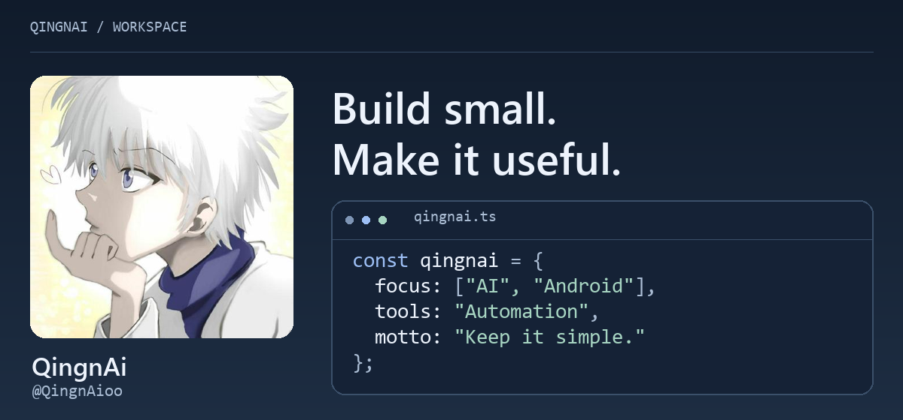

<picture>
  <source media="(max-width: 760px)" srcset="./assets/profile-card-mobile.png">
  
</picture>

  <a href="#about-me">ABOUT</a> ·
  <a href="#selected-work">PROJECTS</a> ·
  <a href="https://github.com/QingnAioo?tab=repositories">REPOSITORIES</a>

## About me

喜欢折腾 **AI 工具、Android 和自动化**。
把重复的事情交给代码，把想法做成能用的小工具。

- **AI & Agent Skills** — 提示词优化、需求澄清、可复用工作流。
- **Android** — 固件工具、真我系统回退包整理。
- **Automation** — 用脚本省掉重复操作。

## Selected work

| 项目 | 做点什么 |
| :--- | :--- |
| [Prompt Optimizer](https://github.com/QingnAioo/prompt-optimizer) | 分析、改进和重构 AI 提示词。 |
| [self.skills](https://github.com/QingnAioo/self.skills) | 整理自用 Agent Skills，覆盖提示词、需求澄清和界面原型。 |
| [Realme Rollback Packages](https://github.com/QingnAioo/realme-rollback-packages) | 按机型整理官方回退包，让回退路径更好查。 |
| [Firmware Extractor](https://github.com/QingnAioo/Firmware_extractor) | Android 固件解包工具。 |

---

Less noise. More useful things.

